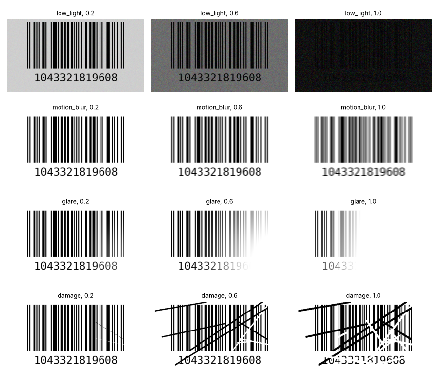
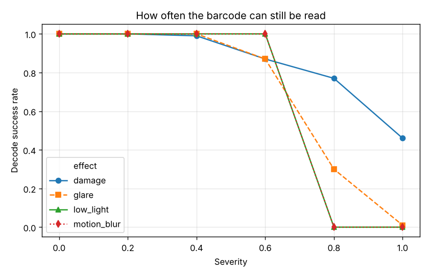

# Synthetic Barcode Stress Test

A small Python project where I create synthetic barcode images, make them look like bad real-world photos, and test when a barcode reader stops working.

I wanted to learn how synthetic data is made for computer vision, and how to check if the data is good enough to use.

## What it does

1. **Makes clean barcodes.** 100 random EAN-13 barcodes with `python-barcode`. The true number of each barcode is saved.
2. **Adds problems.** Four effects, each with a severity from 0 (no change) to 1 (very strong):
   - **low light:** darker image with some camera noise
   - **motion blur:** horizontal blur, like a shaking camera
   - **glare:** a bright white spot, like light reflecting on the label
   - **damage:** random scratches on the label
3. **Saves labels.** Every image gets a row in `labels.csv` with the true value, the effect and the severity. In total 2,400 images.
4. **Checks the data.** For each image I measure brightness and sharpness (variance of the Laplacian), and I try to read the barcode with `pyzbar`. If the decoded number matches the true number, it counts as correct.
5. **Plots the results.**

## Example images



## Results



What I found:

- All four effects are fine at low severity. Every barcode was read correctly up to severity 0.4.
- **Low light and motion blur fail suddenly.** The decode rate goes from 100% at 0.6 to 0% at 0.8. There is no slow drop.
- **Glare fails more slowly**, because it only covers part of the barcode. At 0.8 about 30% were still read.
- **Damage is the most robust.** Even at the strongest level, 46% of barcodes could still be read. EAN-13 has a check digit and the reader can often use the parts between scratches.

So for testing a scanner, the most useful images are the ones around the "break point" (severity 0.6–0.8), because that is where the reader starts to fail.

## How to run

```bash
git clone https://github.com/Taanvir-Ahmed/synthetic-barcode-stress-test.git
cd synthetic-barcode-stress-test
pip install -r requirements.txt
python src/generate_barcodes.py
python src/make_dataset.py
python src/check_quality.py
python src/plot_results.py
pytest
```

`pyzbar` needs the zbar library. On Mac: `brew install zbar`.

The images go to `data/` (not uploaded to GitHub because there are many files). The results table is in `results/quality_results.csv`.

## Limitations

- Only one barcode type (EAN-13) and only clean white backgrounds.
- Effects are applied one at a time. Real photos often have several problems together.
- I used only one free reader (zbar), so the results show how this reader behaves, not every scanner.

## Tools

Python, OpenCV, NumPy, pandas, matplotlib, python-barcode, pyzbar, pytest. I wrote the code in PyCharm and used Claude as an AI coding assistant, and checked the outputs myself with the quality metrics and by looking at the images.
